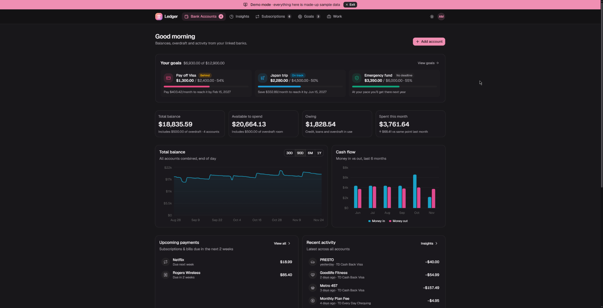
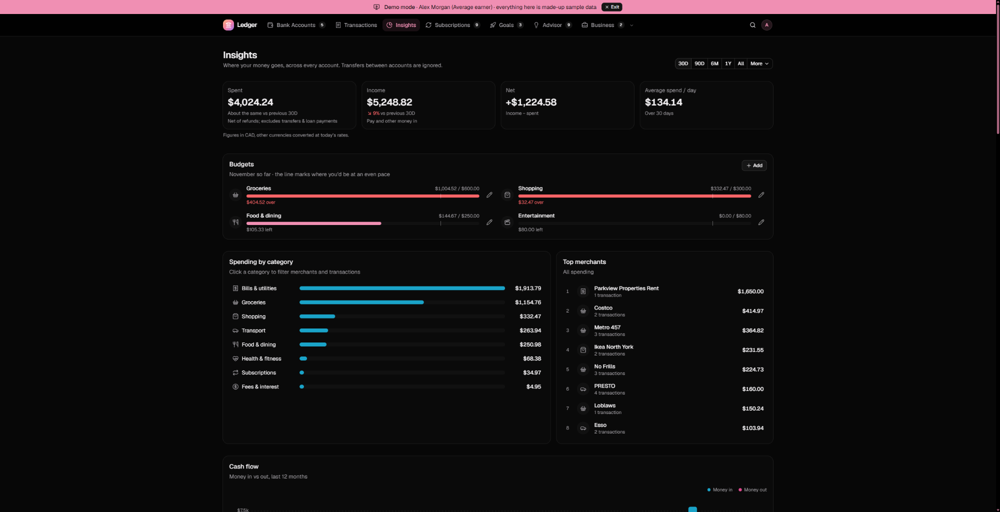
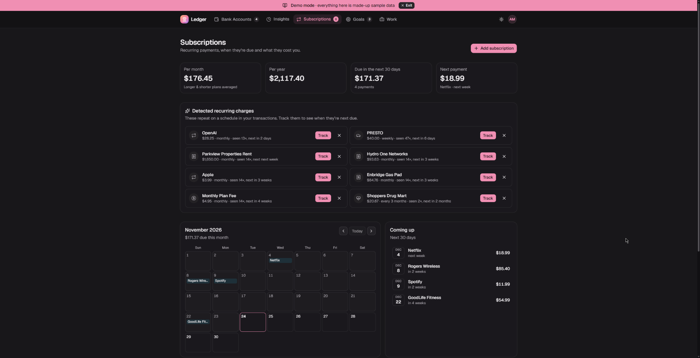
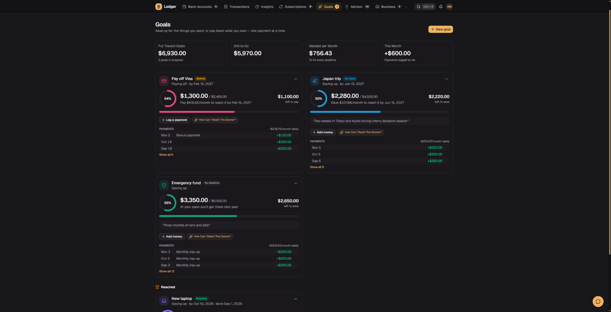
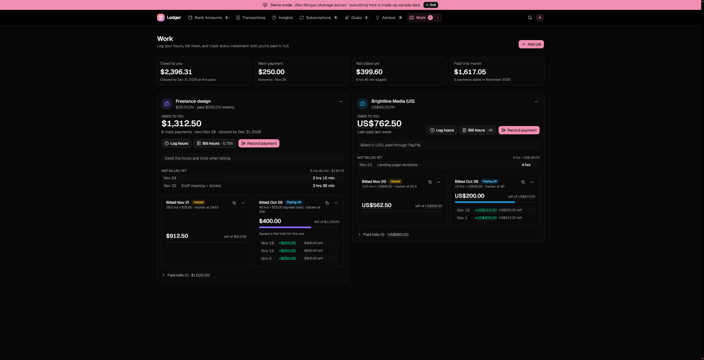

<p align="center">
  
</p>

<h1 align="center">Ledger</h1>

<p align="center">A self-hosted personal finance dashboard that pulls in your bank data on its own.</p>



## Table of contents

- [Why I made it](#why-i-made-it)
- [What it does](#what-it-does)
- [Screenshots](#screenshots)
- [Getting started](#getting-started)
- [Self-hosting](#self-hosting)
- [Connecting accounts](#connecting-accounts)
- [Security](#security)
- [Configuration](#configuration)
- [Built with](#built-with)

## Why I made it

I wanted one place to see my transactions, how much I'm earning, what subscriptions I'm paying for and how close I am to my goals, without logging into a bunch of different sites and copying numbers into a spreadsheet. So I built Ledger. You link your accounts once, and it signs in and fetches new transactions by itself in the background, so everything stays up to date without you touching it.

## What it does

- **Dashboard**: net worth, cash flow and spending for the month, budgets, what needs attention, and quick links to connect a bank or upload statements.
- **Accounts & transactions**: every linked account with balances, overdraft and credit limits, balance history, cash flow, upcoming payments and recent activity; a full **Transactions** page to search, filter, categorise and tag entries.
- **Insights**: spending by category, top merchants and month-by-month cash flow. Transfers between your own accounts are ignored so nothing gets counted twice. **Drag across a chart** to zoom into a date range, then hit Reset zoom.
- **Budgets**: set monthly limits by category on the dashboard and see when you're over.
- **Subscriptions**: track recurring payments on any schedule, see them on a calendar, and get suggestions for recurring charges it spots in your transactions.
- **Goals**: save up for something or pay something off. Log payments as you go and it tells you what you need to put in each month to hit your deadline.
- **Work**: log hours for side work, bill them, and track each payment until you're paid in full.
- **Invoices**: make an invoice from scratch or from a Work bill in a few clicks, pick from three PDF designs, and choose how you want to be paid (e-Transfer, PayPal.me, PayPal checkout, crypto, bank transfer, cash and more). Share a link the client can open without signing in, or send them the PDF. Payments made through PayPal checkout are marked paid on the spot.
- **Taxes**: mark transactions business or personal, review by category, and export a year’s figures or CSV for your accountant.
- **Advisor**: tips from your own numbers—where spending runs high, subscriptions worth a look, and a simple health score—with tips you can dismiss or bring back.
- **Sharing & contacts**: share a goal, subscription or job with another Ledger user, as view-only or editable. Pick them from **Contacts** (in the user menu) or type their email. They need an account on the same server; only the owner can delete, archive or change who it's shared with, and the owner's bank accounts are never shown.
- **Settings**: default currency, invoice defaults, password and two-factor sign-in, and **colour themes** (light/dark plus several accent themes—or match the system).
- **Admin**: manage users, open or close sign-ups, run background tasks, download database backups, read the audit log, and see **update notifications** when a newer release is on GitHub (with upgrade commands to copy).
- **Demo mode**: fills every page with made-up data, handy for showing it off (the screenshots here use it).
- **Any currency**: accounts, goals, subscriptions and bills can each have their own currency. Totals are converted into your default currency (picked in Settings, or guessed from your time zone) using live mid-market rates (refreshed hourly, falling back to the ECB's daily reference rates).
- **Automatic refresh**: saved connections are refreshed every 6 hours in the background.

Ledger currently connects to **TD EasyWeb** and **PayPal**.

## Screenshots

<table>
  <tr>
    <td></td>
    <td></td>
  </tr>
  <tr>
    <td align="center">Insights</td>
    <td align="center">Subscriptions</td>
  </tr>
  <tr>
    <td></td>
    <td></td>
  </tr>
  <tr>
    <td align="center">Goals</td>
    <td align="center">Work</td>
  </tr>
</table>

## Layout

```
apps/web         React + Vite front end
apps/api         Elysia API (Bun, SQLite)
packages/shared  code both sides import (@ledger/shared)
```

Tests live in a `tests/` folder in each package.

## Getting started

You'll need [Bun](https://bun.sh) 1.3+ (the API runs on Bun and uses `bun:sqlite`).

```bash
bun install
bunx playwright install chromium   # used to sign in to TD EasyWeb
cp .env.example .env               # optional, every setting has a default
bun run dev                        # API on :3001, app on http://localhost:5173
```

Create an account (the first one becomes the admin), click **Add account** and pick a bank.

For running your own instance in production, see [Self-hosting](#self-hosting) and [SELF_HOSTING.md](SELF_HOSTING.md).

## Self-hosting

A prebuilt image is published to **`ghcr.io/rainnny7/ledger`** on every push to `master`. Easiest path:

```bash
cp .env.example .env   # set APP_URL, APP_SECRET, etc.
docker compose up -d   # http://localhost:3001 — see docker-compose.yml
```

Data lives in the `./data` mount (database, secret, backups). Full steps—Compose options, bare metal, systemd, reverse proxy, backups, updates and troubleshooting—are in **[SELF_HOSTING.md](SELF_HOSTING.md)**.

## Connecting accounts

**TD.** TD doesn't have a public API, so the server signs in to EasyWeb with a headless browser (Playwright), reads your accounts and transactions, and saves them. You can also **upload statement PDFs** (or a `.zip` of them) for older history. If TD asks for a 2-Step Verification code, the app asks you for it. Refreshes only pull in what's new. Set `TD_HEADLESS=false` to watch the browser while it works.

**PayPal.** Uses PayPal's official REST API. Create a **Live** app on [developer.paypal.com](https://developer.paypal.com/dashboard/applications/live) with a Business account, turn on **Transaction Search**, and paste the app's Client ID and Secret into Ledger.

**PayPal instant updates (optional).** Choose **Turn on instant updates** from the connection's menu and Ledger registers a webhook with your PayPal app. Two limits apply:

- PayPal [webhooks](https://developer.paypal.com/api/rest/webhooks/) only fire for payments that go through your REST app, such as invoice checkouts. Everything else still comes in through the Transaction Search sync, which PayPal can lag by about 3 hours.
- PayPal has to be able to reach the server, so `PUBLIC_URL` must be a public `https://` address (for example a tunnel or your own domain).

## Security

- Your bank password is only saved if you tick **Save credentials**. Saved credentials, API keys and account numbers are encrypted with AES-256-GCM using `APP_SECRET` (generated into `data/.secret` if you don't set one; to pick your own, run `openssl rand -hex 32`).
- Everything lives in a local SQLite database in `data/`. It's git-ignored; don't commit or share it.
- Passwords need at least 10 characters with a lowercase and uppercase letter, a number and a symbol. The server enforces this too.
- Sign-in is rate-limited, sign-ups are closed after the first account unless an admin opens them, and the server sends strict security headers.
- Automated access may be against your bank's terms of service. Use it for your own accounts, at your own risk.

## Configuration

All optional. See [`.env.example`](.env.example). For deployment details see [SELF_HOSTING.md](SELF_HOSTING.md).

| Variable             | Default                                                   | Purpose                                                                                           |
| -------------------- | --------------------------------------------------------- | ------------------------------------------------------------------------------------------------- |
| `PORT`               | `3001`                                                    | API port (app and API share this in production)                                                   |
| `APP_URL`            | `http://localhost:5173`                                   | Public URL of the app (Better Auth trusted origin)                                                |
| `PUBLIC_URL`         | `APP_URL`                                                 | Address used for invoice share links and PayPal webhooks (must be public `https://` for webhooks) |
| `APP_SECRET`         | generated in `DATA_DIR/.secret`                           | Signs sessions and encrypts saved credentials (32+ characters if you set it)                      |
| `DATA_DIR`           | repo `data/`                                              | Where the database and backups live                                                               |
| `TD_HEADLESS`        | `true`                                                    | `false` to watch the browser sign in                                                              |
| `TD_BROWSER_CHANNEL` |                                                           | e.g. `chrome` to use your installed Chrome                                                        |
| `ALLOW_REGISTRATION` | `false`                                                   | Whether sign-ups start open after the first account                                               |
| `TRUST_PROXY`        | `false`                                                   | `true` behind a reverse proxy, so rate limits see the real client IP                              |
| `FX_LIVE_URL`        | `https://api.coinbase.com/v2/exchange-rates?currency=USD` | Where live exchange rates are fetched from (Coinbase-compatible; `off` to turn off)               |
| `FX_RATES_URL`       | `https://api.frankfurter.dev/v1/latest`                   | Fallback daily ECB rates (Frankfurter-compatible)                                                 |
| `PAYPAL_ENV`         | `live`                                                    | `sandbox` to test against PayPal's sandbox                                                        |
| `UPDATE_CHECK`       | `true` (`false` disables)                                 | Poll GitHub for releases (~every 6 hours) for the admin update banner                             |
| `LEDGER_INSTALL`     | `source` (`docker` in the image)                          | Whether the admin UI suggests Docker or source upgrade commands                                   |
| `BACKUPS_KEPT`       | `14`                                                      | How many scheduled backup files to keep in `DATA_DIR/backups`                                     |
| `ALLOWED_HOSTS`      |                                                           | Comma-separated extra hostnames for the Vite dev server only                                      |

## Built with

React, Vite, Tailwind CSS and shadcn/ui on the front end. Elysia, Better Auth, SQLite and Playwright on the server.

```bash
bun run test       # tests
bun run typecheck
bun run lint
```
